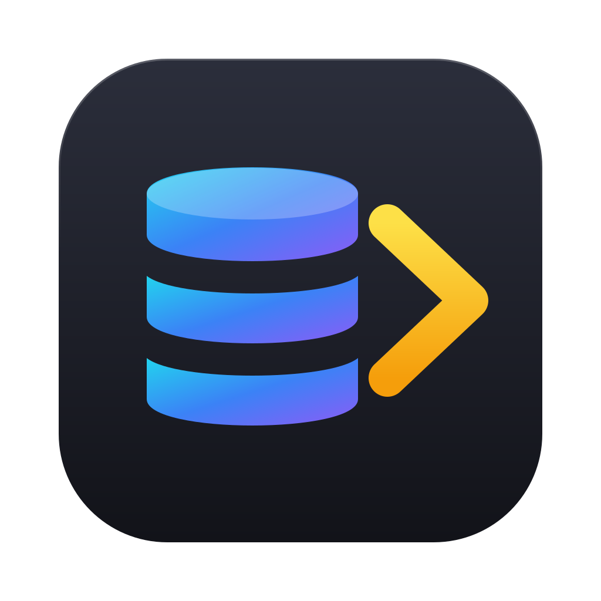
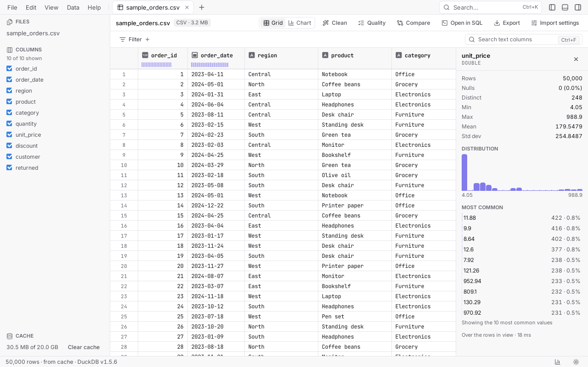
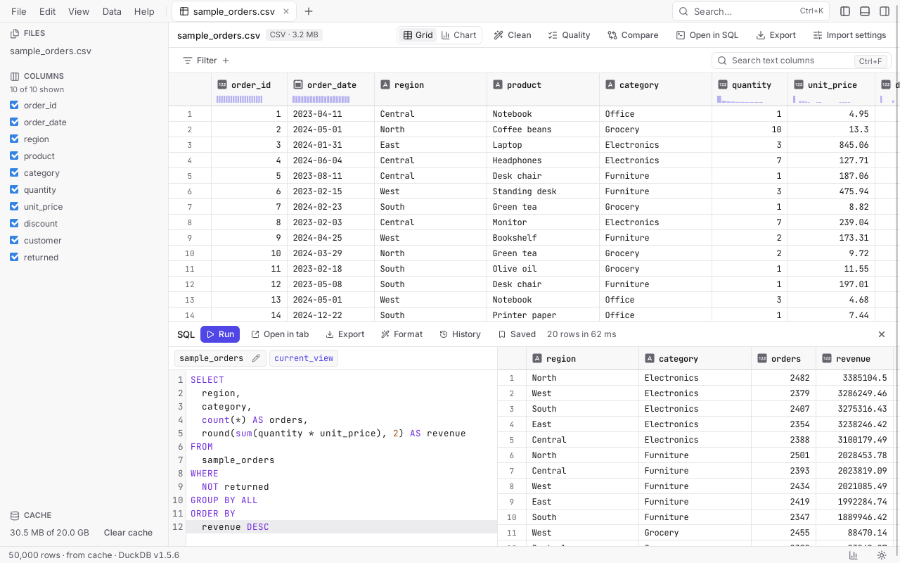
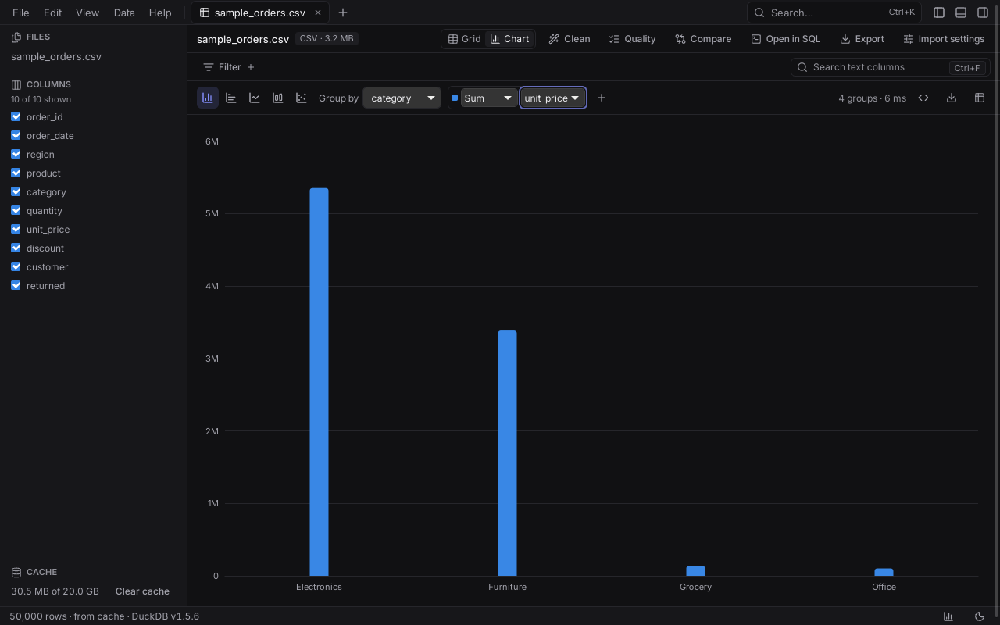

<p align="center"></p>

# DataLiq

> Drag in a 5 GB file. See data in 1 second. Filter, query, and export without loading it into RAM.

DataLiq is a free, open-source, cross-platform desktop app for exploring huge
tabular files: CSV, TSV, Parquet, JSON/NDJSON and Excel, including `.gz`
compressed files of 5 GB and more. It is built with [Tauri v2](https://tauri.app),
Rust and [DuckDB](https://duckdb.org). It works fully offline, with no telemetry
and no account.

**Status:** v1.0 — see [CHANGELOG.md](CHANGELOG.md) for what's in each version,
[PROGRESS.md](PROGRESS.md) for how each step was built and tested, and
[docs/DECISIONS.md](docs/DECISIONS.md) for why things are the way they are.



| SQL over every open file | Charts computed by DuckDB |
| --- | --- |
|  |  |

_The screenshots show the built-in sample dataset (Help › Open the sample dataset)._

## Features

- Open CSV, TSV, JSON and NDJSON files, also compressed (`.gz`, `.zst`), with
  the first 1,000 rows on screen in about a second, even for 5 GB `.gz` files.
  Nested JSON values expand into pretty-printed JSON.
- Parquet is queried in place: a 50M-row file opens in under 0.1 s.
- Excel `.xlsx` and `.xls` with a sheet picker and header row choice.
- SQLite and DuckDB databases, read-only, with a table picker; DuckDB tables
  are queried in place, and every database can be queried and joined in the
  SQL panel.
- A folder or a pattern (`logs/*.csv.gz`, `data/**/*.parquet`) opens as one
  table, columns matched by name, with a `filename` column.
- **Open URL** for files on the web or in S3 (credentials in the system
  keychain); the extension it needs downloads only when you first use it.
- Delimiter, header, quoting and types are detected automatically; override
  them in **Import settings** (delimiter, header, quote, encoding, skip rows,
  date format, ignore bad rows).
- The full file is imported in the background into a local cache (with
  progress and Cancel) while you browse the preview; reopening an unchanged
  file is instant.
- A fast canvas data grid: type icons, right-aligned numbers, `null` shown
  distinctly from empty text, column resize, range selection and copy, and
  **Go to row** (Ctrl+G).
- Filter any column by type (text: contains, equals, starts/ends with, regex,
  empty; numbers: equals, ranges, greater/less; dates: ranges, before/after,
  last N days; booleans; null / not null) or by picking values from a
  searchable list with counts. Filters show as chips; "N of M rows".
- Sort by one or several columns (click, Shift+click). On 50M rows the first
  and last rows appear in about a second while the rest sorts in the
  background.
- Search all text columns (Ctrl+F) with matches highlighted in the grid.
- Hide, reorder (drag), pin, rename and auto-fit columns.
- Column profiles: rows, nulls, distinct values, min, max, mean, standard
  deviation, a histogram and the most common values, following the current
  filters; small histograms in the column headers.
- Command palette (Ctrl+K) with every action; copy a selection as CSV, TSV,
  JSON, Markdown or SQL INSERT (Shift+Ctrl+C); **Copy view as SQL** gives a
  query that reproduces the current view in plain DuckDB; cancel running
  queries from the status bar.
- **SQL panel** (Ctrl+J): every open file is a table (`sales_2024`), plus
  `current_view` for the active tab's filtered rows. Completion of tables and
  columns, run all or the selection, format, errors pointed out in the editor;
  results page through every row, open in their own tab and become tables
  themselves. Searchable history and saved queries.
- **Export** (Ctrl+E) the current view or a SQL result, exactly as shown, to
  CSV, CSV.gz, TSV, Parquet, JSON, NDJSON or Excel (typed cells, more sheets
  past Excel's row limit), with header, delimiter, quoting and date options,
  the whole view or just the selection, progress and Cancel.
- **Open view in SQL panel** turns the current view into a query to edit.
- **Charts** of the current view: bar, horizontal bar, line, histogram and
  scatter, grouped by any column (dates by day, week, month or year) with
  count, sum, average, min, max or distinct count. DuckDB does the work, so a
  chart of 50M rows takes about a second. Export as PNG or SVG, or copy the
  chart as SQL.
- **Clean** without touching the file: rename, change type (failed conversions
  are counted), trim, change case, find and replace, split, fill empty cells,
  remove duplicates or rows matching a filter, and calculated columns; turn
  steps off, reorder them, undo and redo. Save a recipe and apply it to the
  next file, or export it as a SQL script that runs in plain DuckDB.
- **Compare** two open files by key columns: added, removed and changed rows
  with the changed cells highlighted and their old values beside them.
- **Data quality** warnings: mostly empty columns, stray spaces, mixed types,
  inconsistent date formats, outliers and duplicate rows, each one showing
  exactly the affected rows and, where it can, fixing them with one click.
- **Workspaces** (Ctrl+S): save the open tabs with their filters, layout,
  charts and recipes, and the SQL panel, as a `.dataliq` file and open it
  again later, even after moving the project folder.
- A **menu bar** with every action (File, Edit, View, Data, Help), recent
  files and workspaces; **Settings** (Ctrl+,) for theme, density, memory,
  threads, the cache's size and folder, and export defaults.
- Light and dark themes that follow your OS.
- **First run**: three short tips, and a sample dataset (50,000 made-up orders) to try
  everything on before you have a file at hand.
- **Updates** from signed GitHub releases: DataLiq checks at most once a day (you can turn it
  off), shows what's new, and installs only when you say so.
- **Accessible**: WCAG 2.2 AA contrast in both themes, every action reachable from the
  keyboard (menus, the command palette, a command per column for sorting, filtering and
  profiles), visible focus everywhere; checked by automated tests.
- Tabs, recent files and drag and drop; open files from a terminal with
  `dataliq data.csv.gz other.parquet` (a second launch opens them in the
  running app).

## Keyboard shortcuts

Use Cmd on macOS, Ctrl elsewhere.

| Action | Shortcut |
| --- | --- |
| Menu bar (Windows, Linux) | Alt or F10 |
| New workspace | Ctrl+N |
| Open file | Ctrl+O |
| Open folder as one table | Shift+Ctrl+O |
| Save workspace / Save as | Ctrl+S / Shift+Ctrl+S |
| Command palette | Ctrl+K |
| Find in data | Ctrl+F |
| Close tab | Ctrl+W (or Delete on a focused tab) |
| Next / previous tab | Ctrl+Tab / Ctrl+Shift+Tab (arrows in the tab bar) |
| Go to row | Ctrl+G |
| Copy selection (TSV) | Ctrl+C |
| Copy as CSV / JSON / Markdown / SQL | Shift+Ctrl+C |
| Sort by a column / add a sort key | Click / Shift+click a header |
| Export | Ctrl+E |
| Show / hide the SQL panel | Ctrl+J |
| Run SQL (or the selection) | Ctrl+Enter |
| Leave the SQL editor (Tab indents there) | Escape, then Tab |
| Show / hide the sidebar | Ctrl+B |
| Show / hide the column profile | Ctrl+Alt+B |
| Settings | Ctrl+, |

## Performance

Measured with the dev profile on GitHub-hosted runners (4 vCPU) and a 4-core Linux machine;
every number per OS is in [docs/BENCHMARKS.md](docs/BENCHMARKS.md).

| | Linux | Windows | macOS |
| --- | --- | --- | --- |
| First rows of a 5 GB CSV | 0.28 s | 0.34 s | 0.30 s |
| First rows of a 5 GB `.csv.gz` | 1.2 s | 1.4 s | 0.9 s |
| Full import of a 5 GB CSV (46M rows) | 40 s | 48 s | 19 s |
| Reopen a cached file | 2 ms | 3 ms | 2 ms |
| Open a 50M-row Parquet file | 0.05 s | 0.07 s | 0.04 s |
| Filter 50M rows: first rows | 0.1–0.9 s | 0.1–1.1 s | 0.02–0.2 s |
| Sort 50M rows: first and last rows | 0.8–1.0 s | 0.9–1.2 s | 0.3 s |
| Column profile of 50M rows | 0.7–2.7 s | 0.6–2.6 s | 0.2–2.9 s |
| Chart of 50M rows | 0.1–1.9 s | 0.1–2.3 s | 0.04–1.5 s |

## How it works

DataLiq is a [Tauri](https://tauri.app) app: a Rust backend with an embedded
[DuckDB](https://duckdb.org) engine, and a React interface drawn in the system's web view
(WebView2, WKWebView or WebKitGTK), so the installers are small and nothing runs in a browser.

- **Opening** a file reads just enough to detect its format, dialect and types, and shows
  the first rows straight from the file. Parquet, DuckDB databases and URLs are then queried
  in place; text formats and Excel are imported in the background into a DuckDB database in
  the cache folder (with progress and Cancel), keyed by the file's path, size and time, so
  opening it again is instant.
- **Every view is SQL.** Filters, search, sorting, cleaning steps and charts are turned into
  one DuckDB query over the file's table (Copy view as SQL shows it). The grid asks for the
  500 rows it needs at a time, delivered as Arrow, so scrolling through 50M rows never loads
  them all; big sorts and filters show their first rows at once and are written in full in
  the background.
- **Nothing leaves your computer**: no account, no telemetry. The only network requests are
  the URLs you open, the DuckDB extensions those need (downloaded once), and, if you keep it
  on, a daily check for a new version.
- Memory is bounded by DuckDB's limit (half the RAM by default, in Settings); larger work
  spills to a temporary folder.

The design is described in [docs/ARCHITECTURE.md](docs/ARCHITECTURE.md).

## Installing

Download the installer for your system from the
[releases page](https://github.com/mukesh-dsnl/dataliq/releases); each release lists SHA-256
checksums of its files.

- **Windows 10/11 (x64)**: `DataLiq_<version>_x64-setup.exe` (installs for you only, no admin
  rights needed) or `DataLiq_<version>_x64_en-US.msi` (for managed machines). WebView2 is
  included in Windows 11 and installed by the setup if missing. If SmartScreen warns about an
  unrecognised app, choose More info › Run anyway.
- **macOS 12 or later**: `DataLiq_<version>_universal.dmg` (Apple silicon and Intel). Open it
  and drag DataLiq to Applications. If the release isn't notarized, the first time
  right-click DataLiq › Open.
- **Linux (x64)**: `DataLiq_<version>_amd64.AppImage` (any distribution: `chmod +x`, then run
  it), `.deb` (Debian, Ubuntu: `sudo apt install ./DataLiq_<version>_amd64.deb`) or `.rpm`
  (Fedora, openSUSE: `sudo dnf install ./DataLiq-<version>-1.x86_64.rpm`). They need
  WebKitGTK 4.1, preinstalled on most desktops.

The installers register DataLiq for CSV, TSV, JSON, NDJSON, Parquet, Excel, SQLite and DuckDB
files and `.dataliq` workspaces (Settings says how to make it the default app). From a
terminal, `dataliq data.csv.gz other.parquet` opens files in a running DataLiq.

## Building from source

Prerequisites:

- Rust (stable) and Node.js 22 with pnpm 10
- Linux: `libwebkit2gtk-4.1-dev build-essential curl wget file libxdo-dev libssl-dev libayatana-appindicator3-dev librsvg2-dev`
- macOS: Xcode command line tools
- Windows: Microsoft C++ Build Tools and WebView2 (preinstalled on Windows 11)

```sh
pnpm install
pnpm tauri dev          # run the app with hot reload
pnpm tauri build        # build installers into target/release/bundle
./scripts/check.sh      # run every check (fmt, clippy, tests, lint, build)
pnpm fixtures all       # generate the large test files (16+ GB, git-ignored)
pnpm bench              # small benchmark suite with the regression guard
```

## Contributing

Bug reports, ideas and pull requests are welcome: see [CONTRIBUTING.md](CONTRIBUTING.md).
Releases are made as described in [docs/RELEASING.md](docs/RELEASING.md).

## License

[MIT](LICENSE). DataLiq uses DuckDB (MIT), Tauri (MIT/Apache-2.0) and other open-source
libraries under their own licenses.
